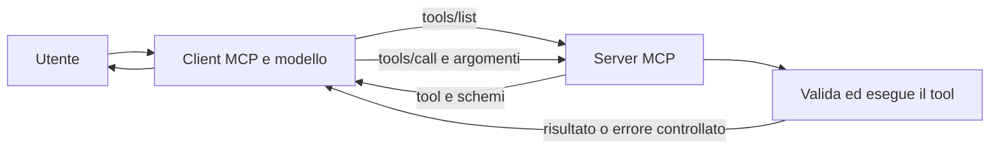

# Creare un server MCP in C# con .NET

Questa guida spiega come costruire un server MCP essenziale, usando come esempio il progetto in questo repository. Il server rende disponibili due tool che un client MCP, come GitHub Copilot, può scoprire e invocare.

## 1. Capire i componenti

Un server MCP espone funzionalità a un client attraverso il protocollo Model Context Protocol. Il client gestisce la conversazione con il modello e, quando necessario, invia al server una richiesta per scoprire o invocare un tool. Il server esegue il codice e restituisce il risultato: non è il modello a eseguire direttamente il codice C#.

I componenti principali sono:

- **Protocollo e SDK**: gestiscono messaggi, trasporto, scoperta, dispatch e serializzazione.
- **Trasporto**: collega il processo server al client, per esempio tramite `stdio` o Streamable HTTP.
- **Tool**: metodi C# esposti al client con nome, descrizione, parametri e comportamento.
- **Client MCP**: avvia o raggiunge il server, scopre i tool e ne presenta le chiamate.



## 2. Creare il progetto e aggiungere lo SDK

Serve l'SDK .NET 10. Per un nuovo progetto web si può partire da:

```powershell
dotnet new web -n MioServerMcp
cd MioServerMcp
dotnet add package ModelContextProtocol.AspNetCore
```

Il pacchetto ufficiale `ModelContextProtocol.AspNetCore` include le API server e il trasporto HTTP. Per usare `stdio` e HTTP nello stesso progetto demo è sufficiente lo stesso pacchetto.

Nel progetto di esempio, il target framework e il riferimento al pacchetto sono dichiarati in [McpDemo.csproj](src/McpDemo/McpDemo.csproj):

```xml
<PropertyGroup>
  <TargetFramework>net10.0</TargetFramework>
</PropertyGroup>
<ItemGroup>
  <PackageReference Include="ModelContextProtocol.AspNetCore" Version="2.4.0" />
</ItemGroup>
```

Usare una versione dello SDK compatibile con il framework scelto e consultare la documentazione ufficiale per le API aggiornate.

## 3. Implementare un tool

Un tool è un metodo C# marcato con `[McpServerTool]`. La classe che contiene uno o più metodi va marcata con `[McpServerToolType]`. Gli attributi `[Description]` documentano il tool e i parametri: lo SDK usa le firme e i metadati per ricavare le descrizioni e gli schemi da comunicare al client.

Esempio semplificato, ispirato al tool `saluta` in [DemoTools.cs](src/McpDemo/Tools/DemoTools.cs):

```csharp
using System.ComponentModel;
using ModelContextProtocol;
using ModelContextProtocol.Server;

[McpServerToolType]
public sealed class MioTool
{
    [McpServerTool(Name = "saluta", ReadOnly = true, Idempotent = true)]
    [Description("Restituisce un saluto per il nome indicato.")]
    public static string Saluta(
        [Description("Nome da salutare.")] string nome)
    {
        if (string.IsNullOrWhiteSpace(nome) || nome.Trim().Length > 80)
        {
            throw new McpException("Il nome deve contenere da 1 a 80 caratteri.");
        }

        return $"Ciao, {nome.Trim()}!";
    }
}
```

Prima di aggiungere un tool:

1. Scegliere un nome e una descrizione chiari e indicare i parametri con descrizioni precise.
2. Validare gli input nel metodo: lo schema aiuta il client, ma non sostituisce la validazione sul server.
3. Restituire un risultato semplice o un tipo C# adatto alla serializzazione.
4. Usare `McpException` per errori attesi, con messaggi sicuri che non rivelino dettagli interni.
5. Dichiarare annotazioni come `ReadOnly` e `Idempotent` soltanto quando descrivono davvero il comportamento del tool.
6. Aggiungere test per risultati, limiti degli input ed errori.

Nel progetto di esempio, `calcola_iva` mostra anche un risultato tipizzato (`VatResult`) esposto come contenuto strutturato MCP.

## 4. Registrare i tool e scegliere il trasporto

Lo SDK configura il server tramite dependency injection. Il metodo `.WithTools<MioTool>()` registra la classe dei tool; è questa registrazione che li rende disponibili per `tools/list` e `tools/call`.

### Streamable HTTP

Per un server ASP.NET Core, registrare il trasporto e mappare l'endpoint MCP:

```csharp
using ModelContextProtocol.AspNetCore;

var builder = WebApplication.CreateBuilder(args);

builder.Services.AddMcpServer()
    .WithHttpTransport()
    .WithTools<MioTool>();

var app = builder.Build();
app.MapMcp("/mcp");
await app.RunAsync();
```

Il client MCP si collega a `/mcp`; non è una rotta REST da aprire nel browser né un endpoint per invocare il tool con una query string. La richiesta e gli argomenti seguono il protocollo MCP, gestito dallo SDK. Lo Streamable HTTP è indicato quando il server è un processo avviato separatamente dal client.

La demo configura il trasporto HTTP in modalità stateless, perché non necessita di sessioni persistenti. Espone inoltre `/health` come endpoint REST separato per verificare soltanto che il processo risponda.

### stdio

Con `stdio`, il client avvia il server come processo figlio e scambia i messaggi MCP tramite input e output standard:

```csharp
var builder = Host.CreateApplicationBuilder(args);
builder.Services.AddMcpServer()
    .WithStdioServerTransport()
    .WithTools<MioTool>();

await builder.Build().RunAsync();
```

In questa modalità **stdout è riservato ai messaggi del protocollo**: non scrivere log o messaggi diagnostici su stdout; indirizzarli a stderr. È la modalità usata dalla configurazione VS Code della demo.

Un processo dovrebbe avviare un solo trasporto. In [Program.cs](src/McpDemo/Program.cs) la demo seleziona `stdio` quando riceve `--stdio`, altrimenti avvia HTTP. In entrambi i casi registra la stessa classe di tool, separando la logica applicativa dal trasporto.

## 5. Collegare un client

Per un client che avvia il processo `stdio`, una configurazione VS Code essenziale ha questa forma:

```json
{
  "servers": {
    "mio-server-mcp": {
      "type": "stdio",
      "command": "dotnet",
      "args": [
        "run",
        "--project",
        "${workspaceFolder}/MioServerMcp.csproj",
        "--",
        "--stdio"
      ]
    }
  }
}
```

Il client deve poter avviare il comando e trovare l'SDK .NET richiesto. Per HTTP, avviare prima il server e configurare il client con l'URL del suo endpoint MCP, ad esempio `http://127.0.0.1:5050/mcp`.

Quando è connesso, il client può chiedere la lista dei tool (`tools/list`), quindi chiamarne uno (`tools/call`) con gli argomenti. Non occorre implementare a mano il parsing JSON-RPC, la generazione degli schemi o il dispatch: queste responsabilità spettano allo SDK.

## 6. Verificare il server

Dalla cartella del progetto o della soluzione:

```powershell
dotnet restore
dotnet build
dotnet test
```

Verificare almeno che:

- gli input validi producano il risultato atteso;
- input mancanti o fuori dai limiti vengano rifiutati;
- i tool siano visibili al client;
- la chiamata e la serializzazione del risultato funzionino sul trasporto scelto.

Nel repository, i test unitari dei tool e i test di integrazione per HTTP e `stdio` sono nel progetto [McpDemo.Tests](tests/McpDemo.Tests).

## 7. Considerazioni per un server reale

La demo è locale e non implementa autenticazione. Prima di esporre un server su una rete o in produzione, progettare autenticazione e autorizzazione, HTTPS, controllo dell'origine, limiti di richiesta, logging e gestione dei segreti. Validare sempre gli input e limitare gli effetti dei tool ai privilegi strettamente necessari. Non considerare le annotazioni dei tool come controlli di sicurezza.

Per i dettagli operativi della demo, inclusi Inspector, avvio e debug, vedere [README.md](README.md). Per le scelte architetturali vedere [ARCHITECTURE.md](ARCHITECTURE.md).
