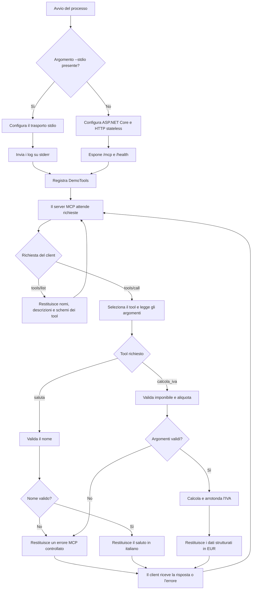

# Flusso di funzionamento

Questo documento descrive l'avvio del server MCP, la comunicazione con il client e il comportamento dei tool dimostrativi.

## Diagramma di flusso

## Descrizione del funzionamento

### 1. Avvio e scelta del trasporto

All'avvio, `Program.cs` controlla se gli argomenti contengono `--stdio`.

- **Con `--stdio`**, il server usa stdin e stdout per il protocollo MCP. Poiché stdout è riservato ai messaggi JSON-RPC, i log vengono inviati a stderr.
- **Senza `--stdio`**, il server avvia ASP.NET Core e usa il trasporto MCP Streamable HTTP in modalità stateless. L'endpoint MCP è `/mcp`; `/health` è un endpoint REST separato che segnala soltanto che il processo risponde.

In entrambi i casi viene registrata la stessa classe `DemoTools`: il trasporto cambia, ma la logica dei tool resta identica.

### 2. Scoperta e chiamata dei tool

Il client MCP stabilisce la comunicazione con il trasporto scelto e può richiedere la lista dei tool (`tools/list`). Lo SDK MCP comunica al client i nomi, le descrizioni e gli schemi derivati dagli attributi e dalle firme C#.

Quando il client invia `tools/call`, lo SDK inoltra la richiesta al metodo corrispondente. Il server valida gli argomenti prima di calcolare o produrre il risultato. Una richiesta non valida genera un errore MCP con un messaggio controllato, senza esporre dettagli interni.

### 3. Tool `saluta`

Il tool riceve `nome` e verifica che non sia vuoto o composto da spazi, che non superi 80 caratteri e che non contenga caratteri di controllo. Se la validazione ha esito positivo, rimuove gli spazi iniziali e finali e restituisce un saluto in italiano.

### 4. Tool `calcola_iva`

Il tool riceve l'imponibile in EUR e l'aliquota percentuale; se l'aliquota non è specificata, usa il valore predefinito del 22%.

1. Verifica che l'imponibile sia compreso tra 0 e 1.000.000 EUR e abbia al massimo due decimali.
2. Verifica che l'aliquota sia compresa tra 0 e 100.
3. Calcola l'IVA con `decimal` e arrotonda a due decimali con `MidpointRounding.AwayFromZero`.
4. Calcola il totale sommando l'imponibile all'IVA arrotondata.
5. Restituisce imponibile, aliquota, IVA, totale e valuta (`EUR`) come risultato strutturato.

Il calcolo è un esempio didattico e non costituisce un motore fiscale.

## Componenti coinvolti

| Componente | Responsabilità |
| --- | --- |
| `Program.cs` | Seleziona il trasporto, registra i tool e configura gli endpoint HTTP. |
| `DemoTools.cs` | Valida gli input ed esegue `saluta` e `calcola_iva`. |
| SDK MCP ufficiale | Gestisce trasporto, protocollo, scoperta dei tool, dispatch e serializzazione delle risposte. |
| Client MCP | Scopre i tool, invia le chiamate e usa i risultati nella conversazione. |

I tool non usano database o servizi esterni e non producono effetti collaterali.
